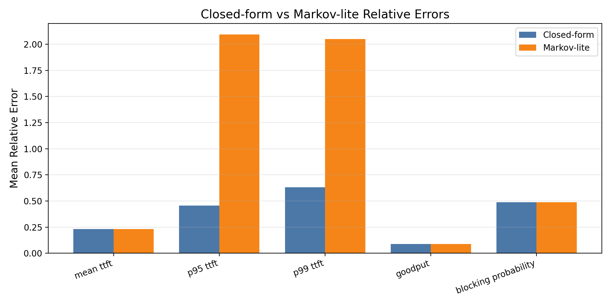
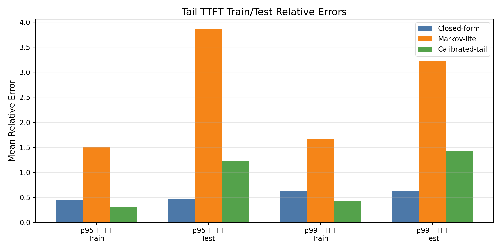
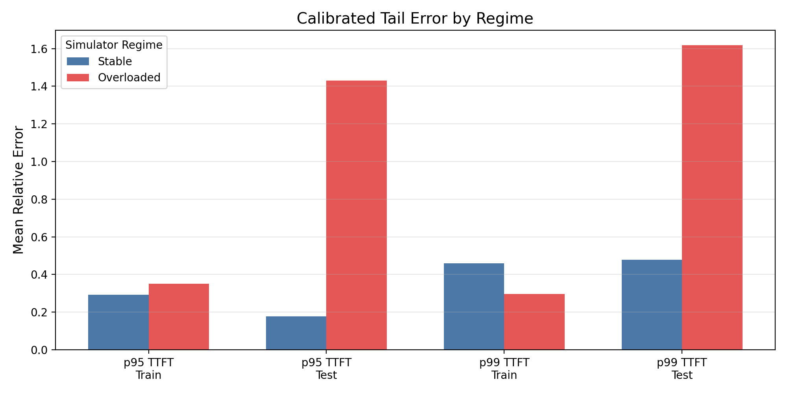
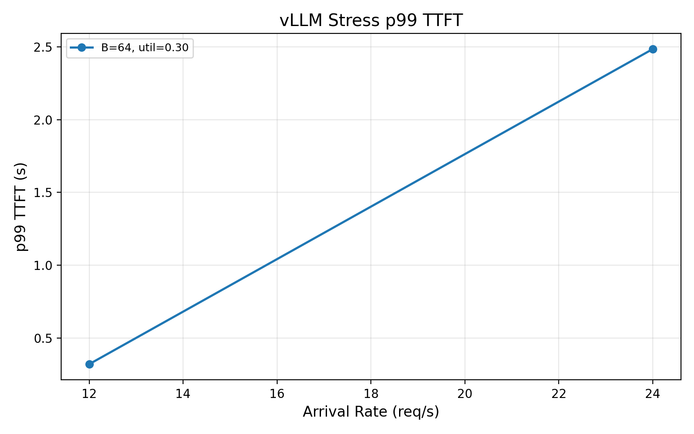
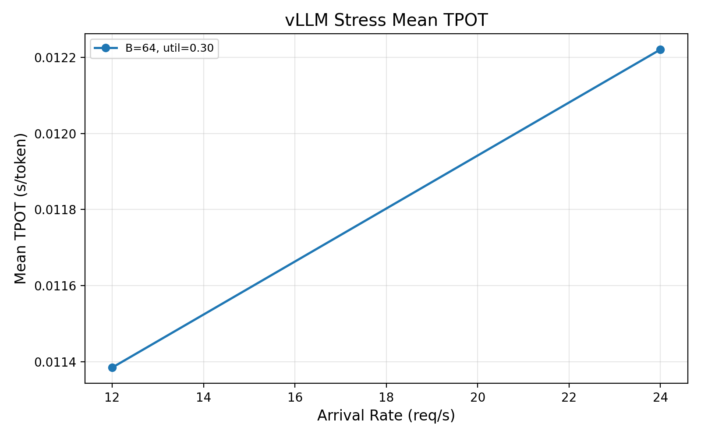
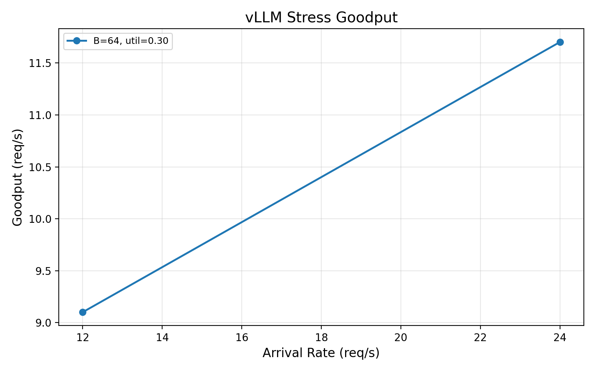

# Queueing-Theoretic Performance Modeling for Continuous-Batching LLM Inference

Adam Alhousiki and Javed Chowdhury

EE 384S Final Project, June 2026

## Abstract

Continuous batching improves LLM serving throughput by keeping many requests
active on the GPU at once, but it also creates queueing effects that are hard to
predict from average load alone. This project studies continuous-batching LLM
inference using a SimPy simulator, queueing-theoretic analytical models, and
Modal/vLLM measurements on `Qwen/Qwen2.5-1.5B-Instruct`. The simulator models
Poisson arrivals, prompt and generation lengths, finite KV-cache capacity,
maximum batch size, simplified prefill/decode phases, TTFT, goodput, and
blocking. We compare two analytical baselines against the simulator: a
closed-form approximation and a Markov-lite birth-death model. Goodput and
average behavior are relatively tractable, while p95/p99 TTFT is much more
sensitive to serving state and overload. A calibrated-tail correction improves
median p95 and p99 TTFT errors, but overload remains difficult. On hardware, a
64-row vLLM sweep validates the real serving pipeline and latency scale. A
two-row vLLM stress sweep provides the key empirical result: increasing offered
load from 12 to 24 req/s raises mean TTFT from 0.056 s to 0.942 s and p99 TTFT
from 0.320 s to 2.485 s, while TPOT rises only from 11.38 to 12.22 ms/token.
This indicates that the overloaded vLLM system is primarily queueing before the
first token rather than dramatically slowing every decode step.

## 1. Introduction

Modern LLM serving systems use continuous batching to keep GPUs highly utilized
while serving requests with different prompt and generation lengths. Instead of
running one fixed batch to completion, the server repeatedly forms iterations
from currently active requests and admits new requests as older ones finish.
This improves throughput, but it also makes performance prediction harder. The
system state changes every decode step, requests consume different amounts of
KV cache, and tail latency depends on rare high-occupancy states.

The central question in this project is whether queueing-theoretic models can
predict LLM serving performance well enough to reduce reliance on expensive
empirical sweeps. We focus on a single-model, single-GPU setting with three
main controls: arrival rate, maximum batch size, and KV-cache budget. The main
metrics are time to first token (TTFT), p95/p99 TTFT, goodput, and request
blocking in simulation. For vLLM, we report request failures and preemptions
rather than calling them simulator-style blocking, because vLLM queues work and
uses different admission semantics.

Our thesis is:

> Low-dimensional analytical models are useful for predicting goodput and
> average behavior, but p95/p99 TTFT is much more sensitive to serving state
> and overload. Calibration improves typical tail estimates, while real vLLM
> measurements confirm that high offered load can create large TTFT queueing
> delays even when per-token decode time changes only modestly.

## 2. System Model

We model a single-GPU continuous-batching server. Requests arrive as a Poisson
process with rate \(\lambda\). Each request has prompt length \(p_i\),
generation length \(g_i\), and KV demand

\[
k_i = p_i + g_i.
\]

The server has maximum active batch size \(B\) and finite KV budget \(K\). In
the simulator, a request is admitted if its KV demand fits in the remaining
budget; otherwise it is rejected. For accepted requests, TTFT is

\[
\mathrm{TTFT}_i = t_{i,\mathrm{first\ token}} - t_{i,\mathrm{arrival}}.
\]

Goodput is the rate of completed requests. Blocking probability in the
simulator is the fraction of arrivals rejected by the finite-capacity admission
rule. TTFT percentiles are computed only over accepted requests that complete
before the simulation horizon, so latency and blocking must be interpreted
together.

The simulator and analytical models share the same simplified iteration-latency
curve. Prefill cost depends on prompt length and active batch size; decode cost
depends primarily on active batch size. This shared service model makes the
analytical-vs-simulation comparison meaningful even though the simulator is not
a full vLLM implementation.

## 3. SimPy Simulator

The SimPy simulator implements a continuous-batching abstraction with:

- Poisson arrivals.
- Lognormal prompt and generation lengths.
- Per-request KV demand.
- Maximum active batch size \(B\).
- Finite KV budget \(K\).
- Simplified prefill and decode phases.
- Per-request arrival, admission, first-token, finish, TTFT, latency, and
  accepted/rejected fields.

The simulator is intentionally compact. It is not meant to reproduce every
vLLM scheduling detail; instead, it gives a controlled queueing environment for
sweeping \(\lambda\), \(B\), and \(K\). The report-facing analytical comparison
uses a 48-row grid:

- arrival rates: 0.5, 1, 2, 3 req/s
- max batch sizes: 1, 4, 8
- KV budgets: 2048, 4096, 8192, 16384

The broader simulator plotting sweep includes higher arrival rates and more
batch sizes to show qualitative trends.

The simulator trends match the expected queueing tradeoff. Higher arrival rates
increase goodput until the system nears saturation. Larger batches increase
effective throughput. Larger KV budgets reduce blocking, but they can also
admit more work and increase accepted-request tail latency. This is why p99
TTFT and blocking must be reported together.

## 4. Analytical Models

### 4.1 Closed-Form Approximation

The closed-form approximation compresses the system into an effective
concurrency cap:

\[
C = \min\left(B, \left\lfloor \frac{K}{E[k]} \right\rfloor \right).
\]

It estimates utilization from \(\lambda E[S] / C\), uses a finite-capacity
blocking approximation, estimates goodput from the accepted arrival rate, and
models TTFT as queueing delay plus first-token service time. Tail percentiles
use a simple utilization-sensitive exponential-tail approximation. This model
is transparent and fast, but it uses average request size and therefore cannot
fully represent rare high-KV or high-queue states.

### 4.2 Markov-Lite Birth-Death Model

The Markov-lite model is a one-dimensional birth-death chain over admitted
request count:

\[
n = 0, 1, \ldots, N, \qquad
N = \left\lfloor \frac{K}{E[k]} \right\rfloor.
\]

Births occur at rate \(\lambda\) for \(n<N\), and arrivals to state \(N\) are
blocked. Death rates depend on active batch size \(\min(n,B)\) and the shared
latency model. Stationary probabilities are computed from birth-death ratios
with safe normalization. Blocking is \(\pi_N\), goodput is
\(\lambda(1-\pi_N)\), and mean occupancy gives mean latency through Little's
law. TTFT percentiles are still approximate, but the model is more state-aware
than a single effective-concurrency formula.

### 4.3 Calibrated Tail Correction

The calibrated-tail model is a lightweight semi-empirical correction. It is not
a pure closed-form model. It leaves Markov-lite mean TTFT, goodput, and
blocking unchanged, and modifies only p95 and p99 TTFT. For each tail metric,
it fits a linear regression on the log residual:

\[
\log\left(\frac{\mathrm{simulated\ tail}}{\mathrm{Markov\ tail}}\right).
\]

Features include arrival rate, max batch size, KV budget, Markov blocking
probability, Markov goodput, an offered-load proxy, and simple interaction
terms. Rows are sorted by configuration, and every fourth row is held out as
test data.

## 5. Analytical Results

### 5.1 Result File Provenance

The final analytical tables use:

- `results/sweep_summary.csv` for simulation.
- `results/closed_form_summary.csv` for closed-form predictions.
- `results/markov_summary.csv` for Markov-lite predictions.
- `results/analytical_error_table.csv` for the closed-form vs Markov-lite table.
- `results/calibrated_tail_error_table.csv` for calibrated-tail errors.
- `results/calibrated_tail_error_by_regime.csv` for stable/overloaded analysis.

`results/comparison_summary.csv` is legacy. It compares the simulator against
`results/analytical_summary.csv`, an older first approximation. The row set is
the same as the final comparison, so the discrepancy is due to model provenance
rather than filtering, metric naming, or different simulator sweep rows.

### 5.2 Closed-Form vs Markov-Lite

| metric | closed-form mean relative error | Markov-lite mean relative error | closed-form median relative error | Markov-lite median relative error |
|---|---:|---:|---:|---:|
| mean TTFT | 0.2315 | 0.2315 | 0.0946 | 0.0946 |
| p95 TTFT | 0.4568 | 2.0955 | 0.4489 | 0.4484 |
| p99 TTFT | 0.6317 | 2.0518 | 0.5950 | 0.5214 |
| goodput | 0.0892 | 0.0892 | 0.0870 | 0.0870 |
| blocking probability | 0.4896 | 0.4896 | 0.0037 | 0.0037 |

Goodput is the strongest analytical result: both models have mean relative
error around 0.089. Mean TTFT is also reasonable, with median relative error
around 0.095. The harder metrics are p95/p99 TTFT and blocking. Blocking has a
small median error but a larger mean relative error because relative error is
unstable when the simulator's blocking probability is near zero. Tail TTFT is
hard because it is dominated by rare overloaded states.

### 5.3 Calibrated Tail Correction

| metric | closed-form mean | Markov-lite mean | calibrated-tail mean | closed-form median | Markov-lite median | calibrated-tail median |
|---|---:|---:|---:|---:|---:|---:|
| p95 TTFT | 0.4568 | 2.0955 | 0.5349 | 0.4489 | 0.4484 | 0.2331 |
| p99 TTFT | 0.6317 | 2.0518 | 0.6744 | 0.5950 | 0.5214 | 0.3418 |

The calibrated-tail correction improves median p95 error from 0.4484 to 0.2331
and median p99 error from 0.5214 to 0.3418. This is a useful improvement, but
it should not be oversold: test mean error remains high for difficult overload
points, so calibration improves typical tail estimates rather than solving tail
latency.

### 5.4 Stable and Overloaded Regimes

We split configurations using simulator blocking probability:

- stable: simulator blocking probability < 0.05
- overloaded: simulator blocking probability >= 0.05

For calibrated-tail test rows:

| metric | stable mean error | overloaded mean error | stable median error | overloaded median error |
|---|---:|---:|---:|---:|
| p95 TTFT | 0.1776 | 1.4300 | 0.1776 | 0.4588 |
| p99 TTFT | 0.4792 | 1.6169 | 0.4792 | 0.6171 |

This shows that the large held-out mean errors are dominated by overloaded
configurations. The overloaded medians are much smaller than the overloaded
means, so a few saturated points drive the average. This is exactly where
tail-latency prediction needs either richer state or empirical calibration.

## 6. vLLM Measurements

The empirical harness runs vLLM on Modal/A10G with
`Qwen/Qwen2.5-1.5B-Instruct` and vLLM `0.22.0`. The 64-row sweep uses the
canonical ShareGPT trace and measures 300 requests plus 8 warmups per row.

| arrival rate (req/s) | mean TTFT (s) | max p99 TTFT (s) | mean goodput (req/s) | mean TPOT (ms/token) |
|---:|---:|---:|---:|---:|
| 0.5 | 0.0365 | 0.1455 | 0.4945 | 8.29 |
| 1.0 | 0.0335 | 0.1121 | 0.9780 | 8.40 |
| 2.0 | 0.0367 | 0.1571 | 1.9132 | 8.63 |
| 3.0 | 0.0380 | 0.1554 | 2.8074 | 8.80 |
| 4.0 | 0.0380 | 0.1418 | 3.6639 | 9.00 |
| 5.0 | 0.0393 | 0.1137 | 4.4829 | 9.22 |
| 6.0 | 0.0417 | 0.1396 | 5.2667 | 9.52 |
| 8.0 | 0.0461 | 0.1850 | 6.7319 | 10.21 |

The 64-row sweep validates the Modal-to-vLLM measurement pipeline and gives a
real latency scale for the model on A10G. Goodput rises approximately linearly
over the measured range, and TPOT increases from about 8.3 to 10.2 ms/token as
load rises. Request failures and preemption count were zero in all 64 rows.
The hardware sweep validates the measurement pipeline and real latency scale.
The stress sweep below additionally demonstrates queueing pressure, but neither
sweep triggered KV-cache preemption or request failures.

## 7. vLLM Stress Sweep

The original 64-row sweep did not reach a high-pressure regime. We therefore
ran a tiny two-row stress sweep rather than another large grid. The stress run
uses arrival rates 12 and 24 req/s, `max_num_seqs=64`,
`gpu_memory_utilization=0.3`, `max_model_len=4096`, 200 measured requests, and
4 warmups. Realized KV cache was 108,704 tokens, or 6,794 blocks of size 16.

| arrival rate (req/s) | mean TTFT (s) | p95 TTFT (s) | p99 TTFT (s) | mean TPOT (ms/token) | goodput (req/s) | peak concurrency | failures | preemptions |
|---:|---:|---:|---:|---:|---:|---:|---:|---:|
| 12 | 0.0558 | 0.1005 | 0.3198 | 11.38 | 9.10 | 68 | 0 | 0 |
| 24 | 0.9424 | 2.4022 | 2.4851 | 12.22 | 11.70 | 121 | 0 | 0 |

This is the strongest empirical result. Moving from 12 to 24 req/s increases
mean TTFT from 0.056 s to 0.942 s and p99 TTFT from 0.320 s to 2.485 s. In
contrast, TPOT increases only modestly from 11.38 to 12.22 ms/token. The
overload effect is therefore mainly queueing before first token, not a large
decode-step slowdown. The run still has zero failures and zero preemptions, so
it demonstrates queueing pressure but not KV-cache preemption.

## 8. Limitations

The simulator abstracts away many implementation details of vLLM, including
exact paged-attention behavior, chunked prefill policy, and preemption
semantics. The analytical models use average request sizes and simplified
service curves, so they cannot fully represent per-request KV variability or
rare bursty states. The calibrated-tail model is semi-empirical and should be
presented as a practical correction, not as a pure analytical solution.

The vLLM measurements are real hardware measurements, but they do not directly
validate simulator-style KV blocking. vLLM queues requests and reports failures
and preemptions rather than using the simulator's immediate rejection rule. The
stress sweep validates queueing pressure under high offered load, while
KV-cache preemption remains a follow-up measurement target.

## 9. Conclusion

This project builds an end-to-end modeling and measurement pipeline for
continuous-batching LLM inference. The SimPy simulator captures finite-KV
admission, batching, TTFT, goodput, and blocking. The closed-form and
Markov-lite analytical models show that average behavior and goodput are
reasonably tractable. Tail latency is harder: p95/p99 TTFT depends on rare
overloaded states, and calibration improves median tail error without fully
solving overload.

The vLLM results complete the story. The 64-row sweep validates the serving
pipeline and latency scale, while the two-row stress sweep shows real queueing
pressure: TTFT grows dramatically at high offered load even though TPOT changes
only modestly. The final takeaway is confident but bounded: low-dimensional
queueing models are useful for capacity planning and average behavior, while
tail latency under saturation needs state-aware simulation, calibrated models,
or direct empirical measurement.
